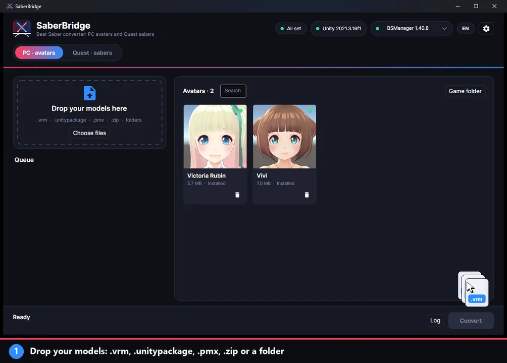
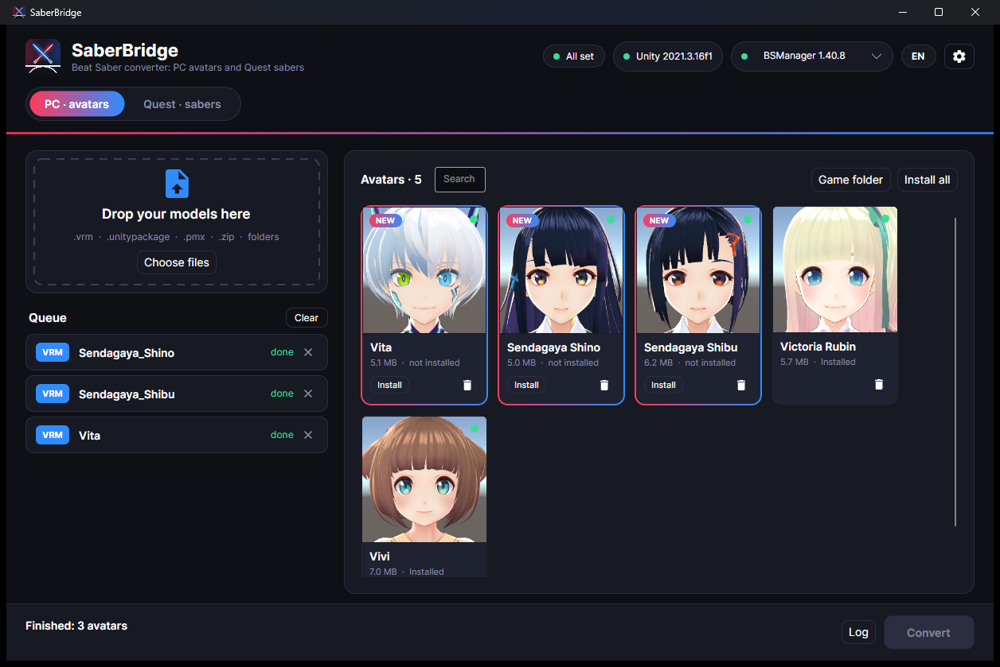
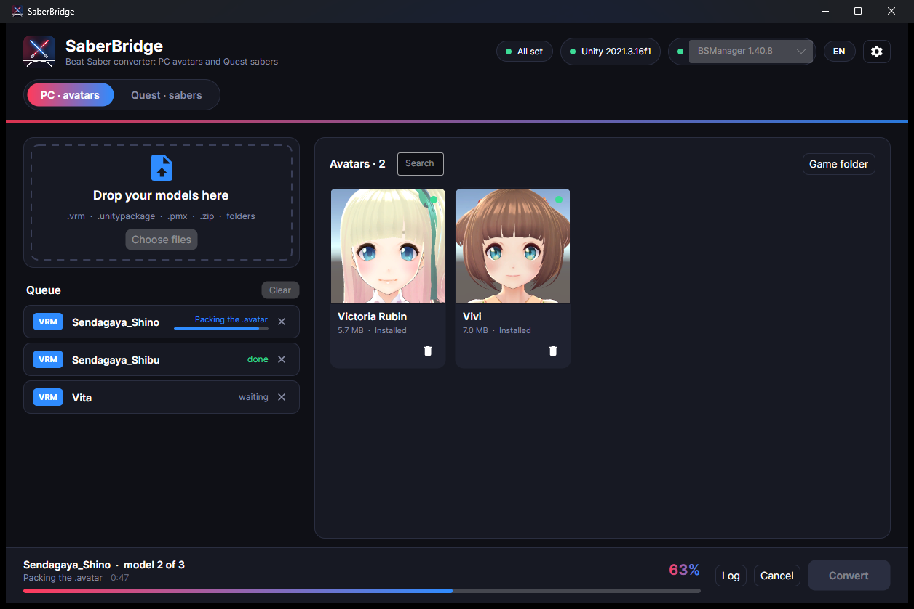
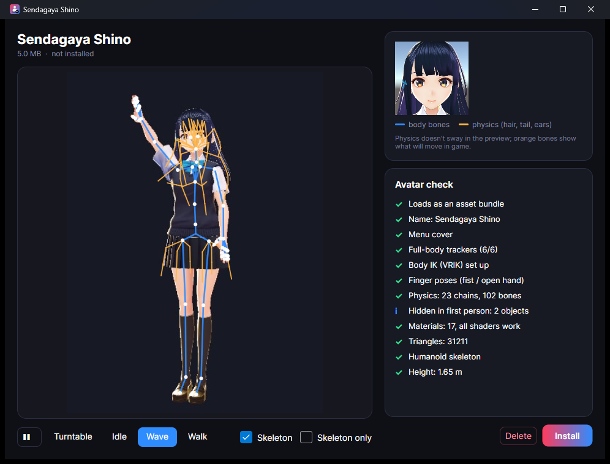
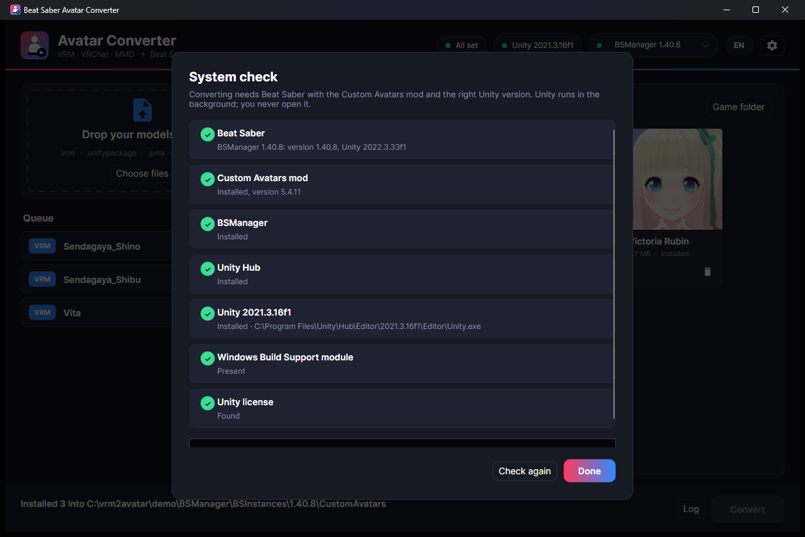

# SaberBridge

Converts VRM, VRChat and MMD models into `.avatar` files for the Beat Saber **Custom Avatars** mod (5.4.x, Beat Saber 1.40). Drop your models into the window and press **Convert**. The app also installs the results into the game. The interface is available in English and Russian.



<sub>[Watch as a video (MP4)](docs/how-to.mp4)</sub>

## How to use it

1. **Drop your models** onto the window (or press *Choose files*): `.vrm`, VRChat `.unitypackage`, MMD `.pmx`, or a `.zip` / folder that contains them.
2. **Press Convert.** Each model shows its current stage (reading the model, skeleton, physics, materials, IK, cover, packing) with a percentage and a timer.
3. **Check the result.** New avatars appear at the top of the library with a **NEW** badge. A coloured dot on each card shows the result of the avatar check (green: all good, orange: worth a look).
4. **Click a card to open its preview.** You can play the idle, wave and walk animations, turn the model with the mouse, and turn the skeleton overlay on or off.
5. **Press Install** (or *Install all*) to copy the avatars into the selected Beat Saber copy. Delete moves a file to the recycle bin.

If something is missing (Unity, Unity Hub, BSManager, the game or the Custom Avatars mod), the **system check** opens on its own. It offers a download or install button for each missing item.

## Screenshots

| Library with fresh conversions | Converting |
|---|---|
|  |  |
| **Preview with skeleton and avatar check** | **System check** |
|  |  |

<sub>Demo models: *Sendagaya Shino*, *Sendagaya Shibu*, *Vita*, *Vivi* and *Victoria Rubin*, the VRoid Studio sample models by pixiv Inc., released under [CC0](https://creativecommons.org/publicdomain/zero/1.0/) (see [pixiv's terms](https://vroid.pixiv.help/hc/en-us/articles/4402614652569)).</sub>

## What it handles

| Input | Notes |
|---|---|
| `.vrm` (0.x and 1.0) | Spring bones become DynamicBone physics; MToon look kept with a Beat Saber friendly shader; VRM thumbnail as cover |
| `.unitypackage` (VRChat avatar) | PhysBones become DynamicBone; Poiyomi colour/decals baked; PC version picked over Quest |
| `.pmx` (MikuMikuDance) | Own PMX reader, Japanese bone names mapped to humanoid, outlines kept |
| `.zip` / folders | Searched for any of the above |

Every avatar gets full-body IK (VRIK), finger poses, first-person head hiding, tail physics when the model has tail bones, a name and a cover.

### In the app

- **System check** — finds Beat Saber (BSManager / Steam), the Custom Avatars version, Unity Hub, the right Unity editor, the Windows build module and the Unity license. Anything missing comes with a button: download and install BSManager, Unity Hub or Unity 2021.3.16f1 from the official sources, or open Unity Hub's install dialog for the exact version. A table shows which Unity builds avatars for which Beat Saber version.
- **Library** — every avatar already installed in the selected game copy, plus fresh conversions on top with a NEW badge. Search, install, replace an older copy in the game, or delete (always to the recycle bin, with a confirmation).
- **Preview** — after converting (or on demand for any installed avatar) Unity loads the `.avatar` the way the mod does, checks it (trackers, IK, finger poses, physics chains, shaders, triangle count, height) and renders a turntable plus idle / wave / walk animations. The preview window plays them with the skeleton drawn on top (body bones blue, physics bones orange); drag to rotate.
- Russian and English UI, picked from the system language, switchable in the header.

## Requirements

- **Unity 2021.3.16f1** installed via [Unity Hub](https://unity.com/download), signed in with a free Personal license. You never open it yourself; the app runs it in the background.
  - On **Linux** also add the module **Windows Build Support (Mono)** to that editor in Unity Hub (avatars are Windows asset bundles).
- **Beat Saber with Custom Avatars** installed (BSManager or Steam). The app takes `FinalIK.dll` and `DynamicBone.dll` from there.
- The first conversion takes 5–10 minutes while Unity imports the project once; after that each model takes about a minute.

## Download

See **Releases**: `SaberBridge-win-x64.exe` (Windows) and `SaberBridge-linux-x64.tar.gz` (Linux). They are single files with no installer.

Data, logs and finished avatars live in `%LOCALAPPDATA%\SaberBridge` (Windows) or `~/.local/share/SaberBridge` (Linux).

You can also drop model files onto the `.exe`, or run `SaberBridge model.vrm --convert`.

## Repository layout

```
app/     Avalonia (.NET 9) desktop app: drag & drop UI, Unity runner, installers
unity/   Unity 2021.3 project: Custom Avatars templates + converter scripts (Assets/VRM2BS) + vendored UniVRM
```

The `unity/` folder is zipped into the app at build time, so the app is self-contained apart from Unity itself.

### Build

```
dotnet publish app -c Release -r win-x64 -o dist/win
dotnet publish app -c Release -r linux-x64 -o dist/linux
```

Pushing a tag `v*` builds both and attaches them to a GitHub release (`.github/workflows/release.yml`).

### Developing the converter scripts

Open `unity/` in Unity 2021.3.16f1 after copying `FinalIK.dll` and `DynamicBone.dll` from your game's `Libs` folder into `unity/Assets/Libraries/`. Batch entry points:

- `VRM2BS.VrmToAvatarConverter.Run -vrmDir <dir> -outDir <dir> [-coverDir <dir>]`
- `VRM2BS.PmxAvatarConverter.Run -jobsFile <file> -outDir <dir>` (lines `Name|body.pmx[|outfit.pmx]`)
- `VRM2BS.VrcAvatarConverter.Run -importDir Assets/VRC_Import/<Name> -outDir <dir>` (optional `variants.txt` for colour variants)
- `VRM2BS.VrmToAvatarConverter.Validate -outDir <dir>`: loads built bundles like the mod does
- `VRM2BS.AvatarPreview.Run -avatarList <file> -previewDir <dir>`: checks `.avatar` files and renders the preview frames

App switches for development: `SABERBRIDGE_DATA=<folder>` uses another data folder (clean demo screenshots); `SABERBRIDGE_SIMULATE_MISSING=1` shows the system check as if nothing were installed.

## Licenses

See [LICENSE-THIRD-PARTY.md](LICENSE-THIRD-PARTY.md). FinalIK and DynamicBone are paid assets and are never included.
