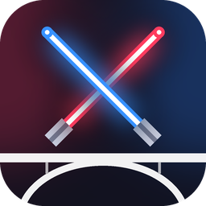
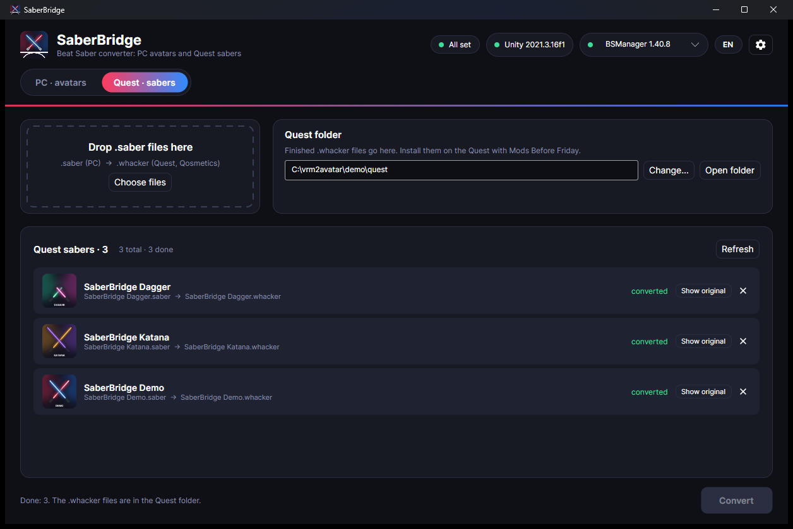

<p align="center"></p>

<h1 align="center">SaberBridge</h1>

<p align="center">A one-window converter for Beat Saber mods on Windows and Linux.</p>

SaberBridge does two things:

- **PC avatars.** It turns VRM, VRChat and MMD models into `.avatar` files for the **Custom Avatars** mod (5.4.x, Beat Saber 1.40) and installs them into the game.
- **Quest sabers.** It turns PC **CustomSabers** files (`.saber`) into **Qosmetics** sabers (`.whacker`) for Beat Saber 1.29+ on a standalone Quest.

Drop your files into the window and press **Convert**. Unity does the building in the background; you never open it yourself. The interface is in English and Russian.


<sub>[Watch as a video (MP4)](docs/how-to.mp4)</sub>

## Download

Get the latest build from [**Releases**](../../releases/latest):

- `SaberBridge-win-x64.exe` for Windows
- `SaberBridge-linux-x64.tar.gz` for Linux

Each is a single file with no installer. On first start the app checks what is missing and offers downloads for it (see [What you need](#what-you-need)).

## PC avatars

1. **Drop your models** onto the window, or press *Choose files*: `.vrm`, a VRChat `.unitypackage`, an MMD `.pmx`, or a `.zip` or folder that contains them.
2. **Press Convert.** Each model shows its current stage (reading the model, skeleton, physics, materials, IK, cover, packing) with a percentage and a timer.
3. **Check the result.** New avatars appear at the top of the library with a **NEW** badge. A coloured dot on each card shows the result of the avatar check: green means all good, orange means worth a look.
4. **Click a card to open its preview.** Play the idle, wave and walk animations, turn the model with the mouse, and turn the skeleton overlay on or off.
5. **Press Install** (or *Install all*) to copy the avatars into the selected Beat Saber copy. Delete moves a file to the recycle bin.

| Input | What happens |
|---|---|
| `.vrm` (0.x and 1.0) | Spring bones become DynamicBone physics; the MToon look is kept with a Beat Saber friendly shader; the VRM thumbnail becomes the cover |
| `.unitypackage` (VRChat avatar) | PhysBones become DynamicBone; Poiyomi colour and decals are baked; the PC version is picked over the Quest one |
| `.pmx` (MikuMikuDance) | Own PMX reader; Japanese bone names are mapped to a humanoid skeleton; outlines are kept |
| `.zip` / folders | Searched for any of the above |

Every avatar gets full-body IK (VRIK), finger poses, first-person head hiding, tail physics when the model has tail bones, a name and a cover.

**Preview.** After converting (or on demand for any installed avatar), Unity loads the `.avatar` the way the mod does and checks it: trackers, IK, finger poses, physics chains, shaders, triangle count and height. It also renders a turntable plus idle, wave and walk animations. The preview window plays them with the skeleton drawn on top (body bones blue, physics bones orange).

| Library with fresh conversions | Converting |
|---|---|
|  |  |
| **Preview with skeleton and avatar check** | **System check** |
|  |  |

## Quest sabers (.saber → .whacker)

1. Open the **Quest · sabers** tab.
2. **Drop `.saber` files**, or a `.zip` with them.
3. **Press Convert.** Unity builds a PC and an Android (Quest) version of each saber and packs them into a `.whacker`.
4. Take the `.whacker` files from the **Quest folder** (by default `Documents\SaberBridge\Quest Sabers`) and install them on the Quest with **Mods Before Friday**.



- **Same layout as Qosmetics' own exporter:** `_Whacker` with `LeftSaber` / `RightSaber`, trails with their colours and length, cover image, name and author.
- **Meshes, textures and colours carry over.** Meshes saved without Read/Write are recovered through a one-off GPU capture.
- **Same size in hand as on PC.** Qosmetics resets the saber object's own scale, so SaberBridge moves the author's scale onto the model.
- **Shaders.** PC-only shaders cannot run on the Quest, so they are swapped for simple Quest shaders (texture, colour, glow, saber colours). Procedural PC effects such as fire or distortion become a soft glow. All shaders are built with the Quest's multiview stereo variants.
- **Originals are never changed or moved.** The tab remembers which `.whacker` came from which `.saber`, shows the cover from the converted file, and notices when a converted file is deleted, so you can convert it again.

Want to try it without a saber of your own? [`samples/`](samples) has three simple demo sabers (public domain, CC0).

## What you need

| | PC avatars | Quest sabers |
|---|---|---|
| [Unity Hub](https://unity.com/download) with a free Personal license | ✔ | ✔ |
| Unity **2021.3.16f1** | ✔ | ✔ |
| Unity module **Android Build Support** | | ✔ |
| Unity module **Windows Build Support (Mono)**, Linux only | ✔ | ✔ |
| Beat Saber with Custom Avatars (BSManager or Steam) | ✔ | |
| Beat Saber 1.29+ with Qosmetics on the Quest | | ✔ |

- Add Unity modules in Unity Hub → *Installs* → ⚙ → *Add modules*.
- The **system check** finds Beat Saber (BSManager / Steam), the Custom Avatars version, Unity Hub, the right Unity editor, the Windows build module (on Linux) and the license. The Quest tab tells you when the Android module is missing. It opens on its own when something is missing and offers a button for each item: download and install BSManager, Unity Hub or Unity 2021.3.16f1 from the official sources, or open Unity Hub's install dialog for the exact version. A table shows which Unity builds avatars for which Beat Saber version.
- The avatar converter takes `FinalIK.dll` and `DynamicBone.dll` from your game's `Libs` folder (they come with the Custom Avatars mod).
- The first conversion of each kind takes a few minutes while Unity imports its project once. After that an avatar takes about a minute and a saber a few seconds.

## Good to know

- Data, logs, previews and finished avatars live in `%LOCALAPPDATA%\SaberBridge` (Windows) or `~/.local/share/SaberBridge` (Linux).
- You can drop files onto the `.exe`, or run `SaberBridge model.vrm --convert`.
- Known limitations and ideas are tracked in [Issues](../../issues).

## Repository layout

```
app/          Avalonia (.NET 9) desktop app: UI, Unity runner, installers, system check
unity/        Unity 2021.3 project for avatars: Custom Avatars templates, converter scripts (Assets/VRM2BS), vendored UniVRM
unity-quest/  Unity 2021.3 project for Quest sabers: converter (Assets/SaberBridge), Quest shaders, CustomSabers script stubs
samples/      CC0 demo sabers
docs/         README images and the how-to animation
```

Both Unity projects are zipped into the app at build time, so the app is self-contained apart from Unity itself.

### Build

```
dotnet publish app -c Release -r win-x64 -o dist/win
dotnet publish app -c Release -r linux-x64 -o dist/linux
```

Pushing a tag `v*` builds both and attaches them to a GitHub release (`.github/workflows/release.yml`).

### Developing the converter scripts

Open `unity/` in Unity 2021.3.16f1 after copying `FinalIK.dll` and `DynamicBone.dll` from your game's `Libs` folder into `unity/Assets/Libraries/`. Batch entry points:

- `VRM2BS.VrmToAvatarConverter.Run -vrmDir <dir> -outDir <dir> [-coverDir <dir>]`
- `VRM2BS.PmxAvatarConverter.Run -jobsFile <file> -outDir <dir>` (lines `Name|body.pmx[|outfit.pmx]`)
- `VRM2BS.VrcAvatarConverter.Run -importDir Assets/VRC_Import/<Name> -outDir <dir>` (optional `variants.txt` for colour variants)
- `VRM2BS.VrmToAvatarConverter.Validate -outDir <dir>`: loads built bundles like the mod does
- `VRM2BS.AvatarPreview.Run -avatarList <file> -previewDir <dir>`: checks `.avatar` files and renders the preview frames

`unity-quest/` needs the Android module and no paid assets:

- `SaberBridge.SaberToWhacker.Run -jobsFile <file>` (lines `source.saber|output folder`)
- `SaberBridge.Probe.Run -dir <folder> -out <file>`: lists what is inside `.saber` / `.whacker` bundles
- `SaberBridge.DemoSaber.Run -out <file.saber> [-name … -len … -width … -guard … -cover …]`: builds the demo sabers

App switches for development: `SABERBRIDGE_DATA=<folder>` uses another data folder (clean demo screenshots); `SABERBRIDGE_SIMULATE_MISSING=1` shows the system check as if nothing were installed.

## License

SaberBridge is released under the [MIT License](LICENSE). Bundled third-party parts keep their own licenses (Custom Avatars: LGPL-3.0, UniVRM: MIT); see [LICENSE-THIRD-PARTY.md](LICENSE-THIRD-PARTY.md). FinalIK and DynamicBone are paid assets and are never included.

<sub>Demo models: *Sendagaya Shino*, *Sendagaya Shibu*, *Vita*, *Vivi* and *Victoria Rubin*, the VRoid Studio sample models by pixiv Inc., released under [CC0](https://creativecommons.org/publicdomain/zero/1.0/) (see [pixiv's terms](https://vroid.pixiv.help/hc/en-us/articles/4402614652569)). Demo sabers: made for this project, CC0.</sub>

<sub>SaberBridge is a fan-made tool and is not affiliated with Beat Games, Meta, Unity, pixiv, or the authors of Custom Avatars, CustomSabers or Qosmetics.</sub>
